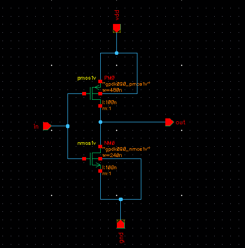

# VLSI CMOS Logic Design

### Transistor-Level Design and Physical Implementation of CMOS Digital Circuits

  
  

## Introduction

This repository documents the design and physical implementation of basic CMOS digital logic circuits using **Cadence Virtuoso** with the **GPDK 90nm technology library**.

The project focuses on understanding how digital logic functions are realized through MOS transistors and translated into physical circuit layouts. I

Each circuit is presented through its operating principle, schematic representation, physical layout and available simulation results.

## Design Environment

| Parameter | Details |
|---|---|
| EDA Platform | Cadence Virtuoso |
| Technology Library | GPDK 90nm |
| Design Method | CMOS Transistor-Level Design |
| Circuit Category | Combinational Digital Logic |
<!--| Physical Design | Custom IC Layout |-->

---

## Circuit Library

The following designs are included in this project:

| No. | Circuit | Logic Function |
|---|---|---|
| 01 | CMOS Inverter | Y = NOT A |
| 02 | 2-Input NAND | Y = NOT (A · B) |
| 03 | 2-Input AND | Y = A · B |
| 04 | 2-Input NOR | Y = NOT (A + B) |
| 05 | 2-Input OR | Y = A + B |
| 06 | M1_NWELL | N-Well Body Connection |
| 07 | MQ_PSUB | P-Substrate Body Connection |

## Design Methodology

The CMOS circuits are developed by studying the required logic function and constructing the corresponding transistor networks.

The design process consists of the following stages:

1. **Logic Analysis:** Identify the Boolean expression and expected output behavior.
2. **Schematic Development:** Construct the circuit using the appropriate MOS devices.
3. **Symbol Representation:** Create a reusable circuit symbol where applicable.
4. **Physical Layout:** Implement transistor placement and electrical interconnections.
5. **Functional Evaluation:** Examine circuit behavior through available simulation waveforms.

---

# CMOS Logic Gate Implementations

## 01. CMOS Inverter (NOT Gate)

### Circuit Description

The CMOS inverter is a fundamental digital circuit that produces an output opposite to its input.

It consists of one PMOS and one NMOS transistor operating in a complementary manner. When the input is LOW, the PMOS provides a conducting path to the supply voltage. When the input is HIGH, the NMOS conducts and connects the output to ground.

**Boolean Expression:**

`Y = A'`

### Logic Verification Table

| Input A | Output Y |
|:---:|:---:|
| 0 | 1 |
| 1 | 0 |

### Circuit Schematic

The schematic illustrates the complementary arrangement of the PMOS and NMOS transistors.

### Physical Layout

The layout represents the transistor placement and interconnections required to implement the inverter.

### Circuit Symbol

The symbol provides a simplified representation of the inverter for use in other digital circuits.

### Transient Response

The expected output waveform is the logical complement of the applied input signal.

---

## 02. Two-Input CMOS NAND Gate

### Circuit Description

The two-input NAND gate performs the complement of the AND operation. Its output remains HIGH for every input combination except when both inputs are HIGH.

The CMOS implementation consists of two PMOS transistors connected in parallel and two NMOS transistors connected in series.

This arrangement allows the output to be pulled LOW only when both NMOS transistors are conducting.

**Boolean Expression:**

`Y = (A · B)'`

### Logic Verification Table

| A | B | Y |
|:---:|:---:|:---:|
| 0 | 0 | 1 |
| 0 | 1 | 1 |
| 1 | 0 | 1 |
| 1 | 1 | 0 |

### Circuit Schematic

The transistor-level circuit demonstrates the parallel pull-up and series pull-down configurations.

### Physical Layout

The physical design incorporates the MOS transistors and routing connections required for NAND functionality.

### Circuit Symbol

The NAND symbol contains two input terminals and one inverted output terminal.

### Transient Response

The expected waveform shows a LOW output only when both input signals are HIGH.

---

## 03. Two-Input CMOS AND Gate

### Circuit Description

The AND gate generates a HIGH output only when both input signals are HIGH.

In a CMOS implementation, the AND function can be obtained by combining a NAND stage with an inverter. The NAND stage produces the complemented AND result, while the inverter restores the required positive logic.

**Boolean Expression:**

`Y = A · B`

### Logic Verification Table

| A | B | Y |
|:---:|:---:|:---:|
| 0 | 0 | 0 |
| 0 | 1 | 0 |
| 1 | 0 | 0 |
| 1 | 1 | 1 |

### Circuit Schematic

The schematic presents the CMOS circuitry used to realize the two-input AND operation.

### Physical Layout

The layout illustrates the physical arrangement of the devices and their electrical connections.

### Circuit Symbol

The AND gate symbol represents the two-input combinational logic function.

### Transient Response

The expected output becomes HIGH only during intervals when both inputs are HIGH.

---

## 04. Two-Input CMOS NOR Gate

### Circuit Description

The NOR gate performs an inverted OR operation. Its output is HIGH only when both inputs are LOW.

At the transistor level, the circuit uses two PMOS transistors in series to form the pull-up network and two NMOS transistors in parallel to form the pull-down network.

This configuration ensures that any HIGH input can activate a discharge path toward ground.

**Boolean Expression:**

`Y = (A + B)'`

### Logic Verification Table

| A | B | Y |
|:---:|:---:|:---:|
| 0 | 0 | 1 |
| 0 | 1 | 0 |
| 1 | 0 | 0 |
| 1 | 1 | 0 |

### Circuit Schematic

The schematic demonstrates the series PMOS and parallel NMOS transistor networks.

### Physical Layout

The layout shows the transistor arrangement and signal routing for the NOR circuit.

### Circuit Symbol

The NOR symbol represents an OR function with an inverted output.

### Transient Response

The expected output is HIGH only when neither input is asserted.

---

## 05. Two-Input CMOS OR Gate

### Circuit Description

The OR gate produces a HIGH output whenever at least one of its inputs is HIGH.

A common static CMOS realization combines a NOR gate with an inverter. The NOR stage initially produces the complemented OR output, which is inverted again to obtain the desired logic function.

**Boolean Expression:**

`Y = A + B`

### Logic Verification Table

| A | B | Y |
|:---:|:---:|:---:|
| 0 | 0 | 0 |
| 0 | 1 | 1 |
| 1 | 0 | 1 |
| 1 | 1 | 1 |

### Circuit Schematic

The schematic illustrates the CMOS implementation of the OR logic function.

### Physical Layout

The layout displays the physical structure and routing of the OR gate circuit.

### Circuit Symbol

The symbol represents the standard two-input OR gate.

### Transient Response

The expected output remains LOW only when both input signals are LOW.

---

# Well and Substrate Connections

In CMOS physical design, proper well and substrate connections are essential for maintaining stable transistor body potentials.

The following cells are included to demonstrate these physical design elements.

## 06. M1_NWELL

### Design Overview

The M1_NWELL cell is associated with establishing an electrical connection to the N-well region used for PMOS devices.

The N-well forms the body region of PMOS transistors in a typical bulk CMOS process. It is normally connected to the positive supply voltage through an appropriate well contact.

Maintaining the correct well potential helps prevent unintended body biasing and supports reliable circuit operation.

### Physical Layout

The image below presents the implemented M1_NWELL connection structure.

---

## 07. MQ_PSUB

### Design Overview

The MQ_PSUB cell is associated with the substrate connection used in NMOS transistor implementations.

In a conventional bulk CMOS process, the P-type substrate provides the body region for NMOS devices. A substrate contact establishes an electrical connection between this region and the designated reference potential, commonly ground.

Proper substrate biasing is important for stable transistor operation and reducing unwanted electrical effects.

### Physical Layout

The following layout illustrates the substrate connection structure.

---

# Project Summary

This project brings together the fundamental concepts of CMOS logic design and custom physical implementation using Cadence Virtuoso.

The collection covers five basic combinational logic gates and two supporting well/substrate connection cells. Together, these designs provide a practical introduction to MOS transistor arrangements, Boolean logic realization, schematic development, and integrated circuit layout.

The repository also serves as a foundation for further exploration of more advanced digital VLSI circuits.

---

## Tools Used

- Cadence Virtuoso
- GPDK 90nm Technology Library
- CMOS Digital Circuit Design

## Author

**[Your Name]**

Department of Electronics and Telecommunication Engineering (ETE)

Chittagong University of Engineering & Technology (CUET)

GitHub: [Your GitHub Profile](https://github.com/your-username)

---

*CMOS VLSI Design | Schematic Development | Custom IC Layout*
